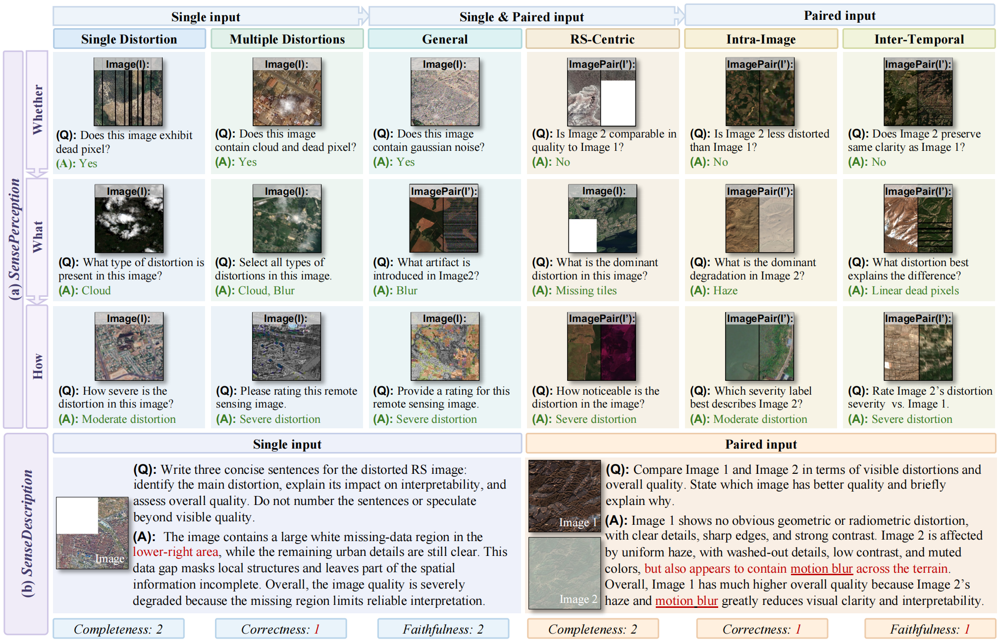

<h1 align="center">🛰️ SenseBench: A Benchmark for Remote Sensing<br>Low-Level Visual Perception and Description<br>in Large Vision-Language Models</h1>

<p align="center">
  <b>Chen Zhong</b><sup>1,*</sup>,
  <b>Xiao An</b><sup>1,*</sup>,
  <b>Jiaxing Sun</b><sup>2</sup>,
  <b>Zihan Gui</b><sup>1</sup>,
  <b>Guangyi Yang</b><sup>1</sup>,
  <b>Wei He</b><sup>1,†</sup>
</p>

<p align="center">
  <b><sup>1</sup>Wuhan University, <sup>2</sup>Shanghai AI Laboratory</b><br>
  <sup>*</sup>Equal contribution &nbsp; <sup>†</sup>Corresponding author
</p>

<p align="center">
  <a href="https://arxiv.org/abs/2605.10576"></a>
  <a href="https://huggingface.co/datasets/Zhongchenchen/SenseBench"></a>
  <a href="https://zhong-chenchen.github.io/SenseBench/#results"></a>
</p>

> **TL;DR:** We introduce SenseBench, a benchmark with over 10K instances across 22 degradation categories for evaluating low-level visual perception and diagnostic description in remote sensing vision-language models.

---

## 🔥 News

- **`2026.09.25`** 🎉🎉 SenseBench has been accepted to **NeurIPS 2026** as a **Poster** (6/5/5)!
- **`2026.05.05`** 🤗🤗 We release the complete SenseBench benchmark in the [Hugging Face Dataset](https://huggingface.co/datasets/Zhongchenchen/SenseBench).
- **`2026.05.02`** 🤗🤗 We release the code for inference and evaluation.

---

## ✨ Overview

<p align="center">
  
</p>

<p align="justify">
  <b>Figure:</b> Overview of the SenseBench evaluation framework. The upper part shows the <i>SensePerception</i> task taxonomy across input formats, distortion settings, and <i>whether</i>/<i>what</i>/<i>how</i> question types. The lower part illustrates <i>SenseDescription</i> examples for single and paired inputs, where responses are evaluated by <i>completeness</i>, <i>correctness</i>, and <i>faithfulness</i>, with <span style="color:red;">red</span> text indicating incorrect or unsupported statements.
</p>

## 🏆 Observations

- **General-domain and RS-specialized VLMs exhibit divergent low-level perceptual priors, with no model achieving balanced high accuracy across both domains.** General-domain VLMs show stronger robustness to generic degradations but fail to generalize well to physics-driven remote sensing artifacts. Conversely, RSVLMs benefit from domain-specific tuning on RS-centric distortions, yet often sacrifice generic degradation robustness, revealing that model capacity alone does not resolve the domain gap.

- **Multi-distortion robustness remains a severe population-level bottleneck for modern VLMs.** Most models suffer substantial performance drops when multiple degradations are superimposed, including top single-distortion performers such as Gemini-3.1-pro-preview and EarthDial. This demonstrates that recognizing isolated artifacts does not imply the ability to disentangle compounded real-world degradations, making stratified multi-distortion evaluation essential.

- **Reference images act as structural anchors for paired perception, but their benefits are highly model-dependent.** General-domain VLMs generally leverage full-reference inputs to improve degradation detection, whereas RSVLMs often regress under paired-image settings, exposing weaknesses in multi-image spatial alignment. Meanwhile, strong single-image models such as InternVL3.5-38B can further improve with paired visual evidence, showing that single-image perception is not a reliable proxy for comparative reasoning.
<hr />

## 🗂️ Data Download

The SenseBench dataset is hosted on Hugging Face and can be downloaded locally for evaluation and reuse.

> Please refer to [docs/data.md](docs/data.md).

## 🛠️ Evaluation Workflow

The core inference and evaluation implementations live in `src/`.

> Please refer to [docs/evaluation.md](docs/evaluation.md).

<hr>

# 📜 Acknowledgements

We gratefully acknowledge the following data sources and platforms that made this project possible:

- **Google Earth** for high-resolution satellite imagery.  
- **Google Earth Engine (GEE)** for planetary-scale geospatial data access and processing tools.
- **Sentinel** satellite data, provided by the European Space Agency (ESA) via the Copernicus Open Access Hub.  
- **Landsat** satellite data, provided by the U.S. Geological Survey (USGS).
- **OpenStreetMap (OSM)** data, contributed by a global community of volunteers and accessed through various mapping services and APIs.

> Use of the Google Earth images must respect the [Google Earth terms of use](https://about.google/brand-resource-center/products-and-services/geo-guidelines/#google-earth). All images and their associated annotations in SenseBench can be used for academic purpose only, any commercial use is prohibited.

# 🏛 License

This project is licensed under the [Creative Commons Attribution 4.0 International License (CC BY 4.0)](https://creativecommons.org/licenses/by/4.0/). You may share and adapt the benchmark materials with appropriate attribution.

---

## 📌 Citation

Please consider citing [our paper](https://arxiv.org/abs/2605.10576) if you find SenseBench useful for your research.

```bibtex
@article{zhong2026sensebench,
  title={SenseBench: A Benchmark for Remote Sensing Low-Level Visual Perception and Description in Large Vision-Language Models},
  author={Zhong, Chen and An, Xiao and Sun, Jiaxing and Gui, Zihan and Yang, Guangyi and He, Wei},
  journal={arXiv preprint arXiv:2605.10576},
  year={2026},
  url={https://arxiv.org/abs/2605.10576}
}
```
